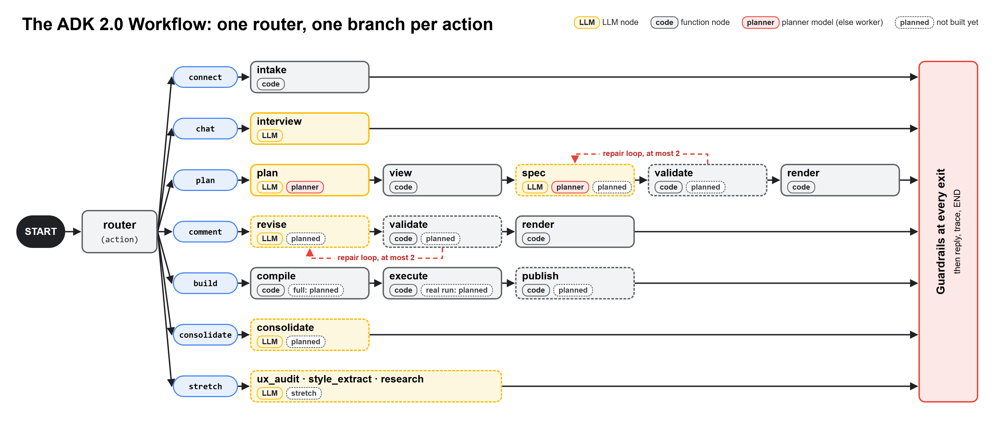
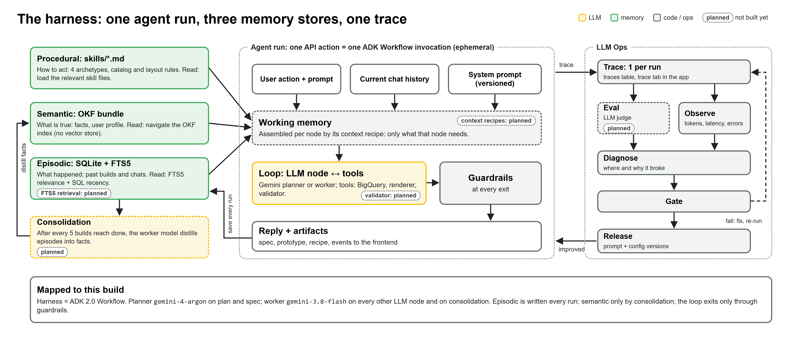
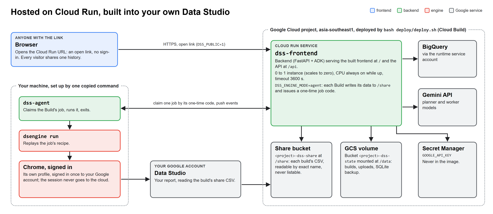
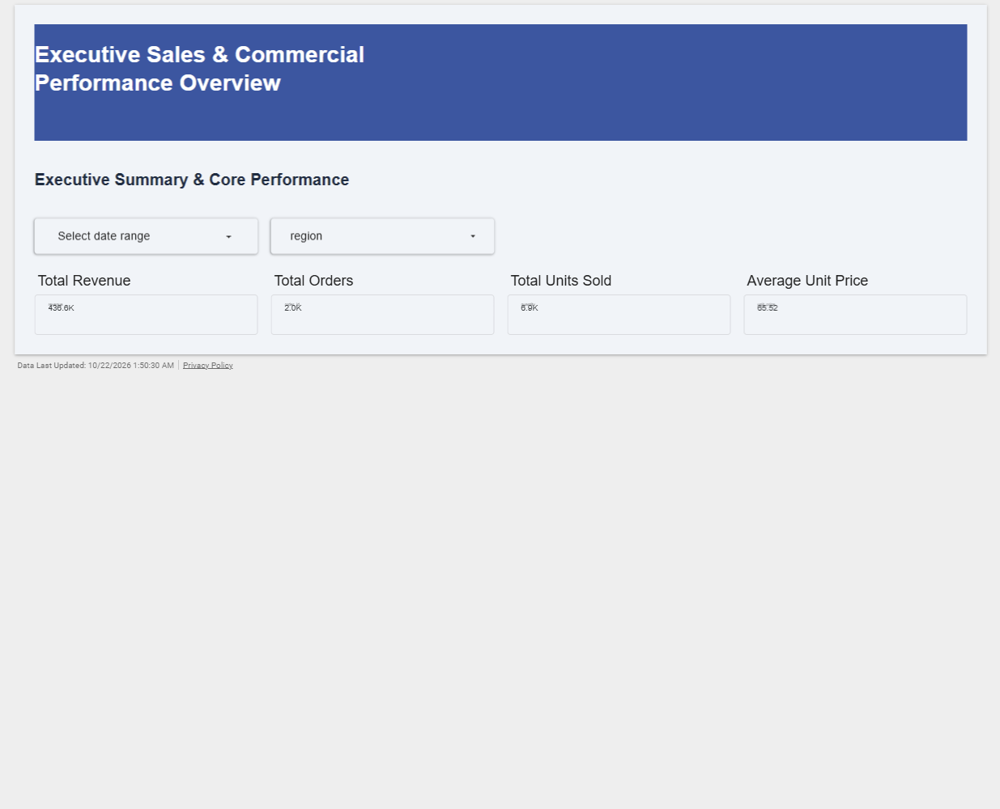
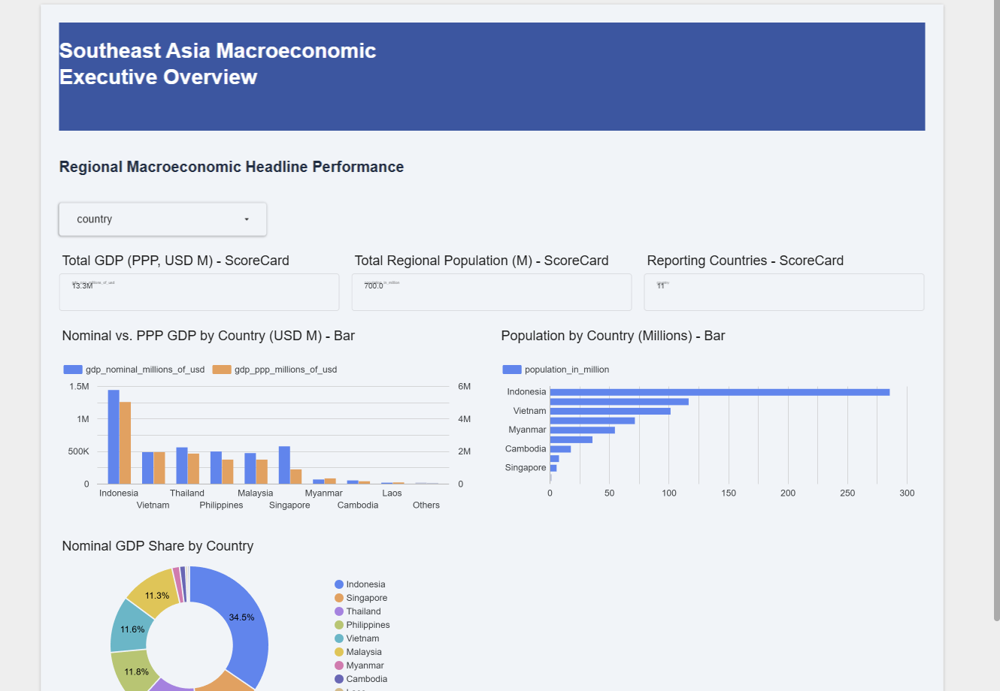
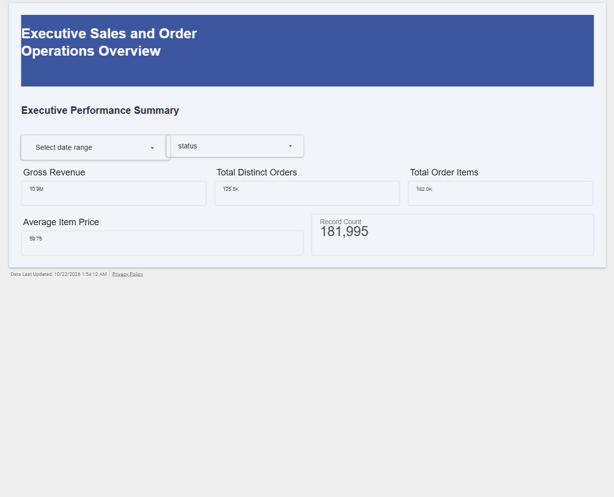
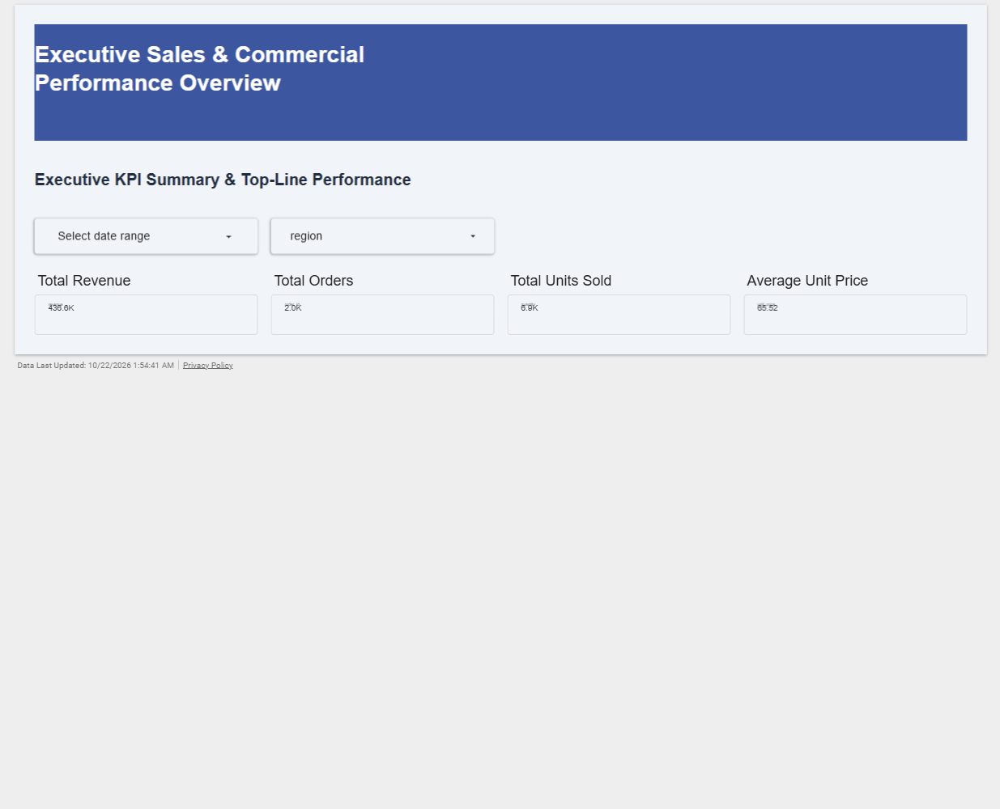
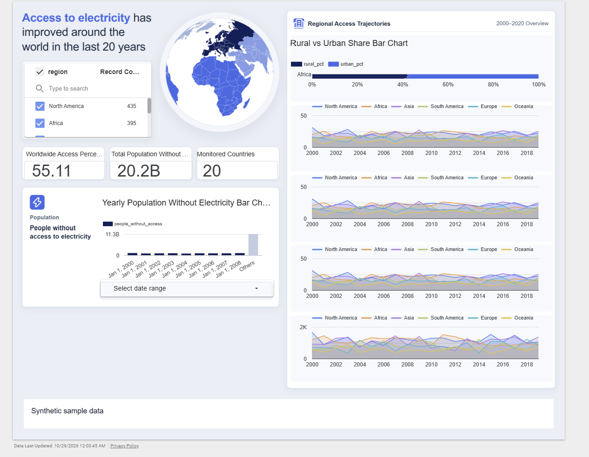

# Democratizing Google Data Studio

An agent that interviews you and builds a real Google Data Studio dashboard.

Meet your own UI/UX designer, data analyst and programmer, building a Data Studio dashboard with you. You bring a CSV, a BigQuery table, a file in Google Cloud Storage, a research question or just a screenshot. It asks what the dashboard is for, proposes an outline and a design, shows a clickable prototype you can comment on, then builds the live report in Data Studio.

## Features

Each one passed the user's manual acceptance ([docs/acceptance.md](docs/acceptance.md)).

- **CSV upload**: a dashboard from `samples/ecommerce_sales.csv` (acceptance row 1, PASS).
- **Research mode**: type a question, the agent finds the data and builds from it (row 2, PASS).
- **BigQuery table**: pick a table in the Connect stage (row 3, PASS).
- **CSV in Google Cloud Storage**: pick a `gs://` file (row 4, PASS).
- **Recreate a dashboard from a screenshot**, with synthetic sample data when you have none (recreate mode: row 5, PASS with findings). Style mode, which borrows only the screenshot's look, passed the automated reference run of 2026-10-23 ([deck/data/bench-references-local.json](deck/data/bench-references-local.json)).

Known weaknesses: the screenshot run built a partial report (engine `partial`, 33 of 49 operations ok): area charts show the wrong fields, some chart boxes are misplaced. They are listed in the "Known weaknesses" table of [docs/acceptance.md](docs/acceptance.md#known-weaknesses-26-to-fix-later).

## Capabilities

- Staged interview: context, outline, design, blueprint.
- HTML prototype with click-to-comment.
- Feasibility check that refuses unsupported requests (the 2026-10-23 reference bench refused animation and temporal playback).
- Component catalog: 12 bound component types (9 charts: scorecard, time_series, area, bar, pie, table, pivot_table, geo_map, scatter; 3 controls: date_range, dropdown, fixed_size_list) plus text and image.
- History and new versions of every build.
- Live activity strip with token counts.
- Hosted on Cloud Run: Build gives a one-time code and one command that builds into your own Data Studio through the build agent (`dss-agent`).

Measured on the live end-to-end run of 2026-10-21 ([deck/data/bench-2026-10-21-live.json](deck/data/bench-2026-10-21-live.json)): 33,851 input and 4,096 output tokens across context, outline, blueprint and comments.

## Simplified architecture

### 1. Graph engineering



Every request is one ADK 2.0 Workflow run. A router reads the action (connect, context, outline, blueprint, prototype, build and more) and sends it down its own branch of LLM nodes and plain code nodes. A feasibility gate refuses what Data Studio cannot do. A failed check triggers one repair loop. Every branch ends in guardrails, a reply and a trace.

### 2. Harness engineering



Procedural memory is a set of skill files. Semantic memory is an OKF bundle the agent navigates through its index: no RAG, no vector store. Episodic memory is SQLite with an FTS5 index. After every few finished builds, consolidation distills episodes into facts. Each node gets only its assembled context, and every run writes one trace.

### 3. Google Cloud



The hosted app is the Cloud Run service `dss-frontend` in asia-southeast1, deployed through Cloud Build with `bash deploy/deploy.sh`. State lives on a GCS volume, the Gemini key in Secret Manager, data in BigQuery, models on the Gemini API. Each Build saves the build's data as one CSV in a share bucket and issues a one-time code. You run one command on your own machine: it sets up `dss-agent`, which claims that one job and drives its own Chrome, signed in to your Google account, to build the report in your Data Studio from the share CSV. Your Google session never leaves your machine.

## Screenshots

Real reports built during acceptance (page 1).


CSV upload: executive dashboard from `samples/ecommerce_sales.csv`.


Research mode: ASEAN nominal GDP, data found by the agent.


BigQuery: `bigquery-public-data.thelook_ecommerce.order_items`.


CSV in Google Cloud Storage.


Recreated from a screenshot, on synthetic data (with known weaknesses).

## Links

- GitHub: https://github.com/Gjandane/democratizing-google-data-studio
- Hosted app: the link is shared privately with the judges (never in this repo).

## Use the hosted app

- **Who gets in**: the link is open, with no sign-in, until the owner closes it after judging ends on 2026-11-07 ([deploy/README.md](deploy/README.md#close-the-link-after-2026-11-07)). Every visitor shares one history: you see and can change every build.
- **Sources**: CSV upload, research, or a screenshot with synthetic data. GCS and BigQuery sources are locked on the hosted link; run it locally with `./start.sh` to use your own GCS or BigQuery.
- **Build into your own Data Studio**: the Build stage gives a one-time code and one command to copy. Run it on your machine; it sets up the build agent and builds the report in the Data Studio of the Google account you sign in with. "Set up this computer" offers the same command with a check code, to install and sign in before the first build. On your first visit the home page explains these steps ("How it works") and offers "Set up this computer" there.
- **Requirements**: Google Chrome. Windows is tested (PowerShell command); macOS and Linux are untested (bash command).
- **First run**: it installs uv and the app into the install folder (`%LOCALAPPDATA%\dss-agent` on Windows, `~/.dss-agent` elsewhere) and asks you to sign in to Google once, in its own Chrome window. Later codes reuse the install and the sign-in. No Git, `.env` or GCP project is needed on your machine.
- **Your data**: each build's data is saved as a CSV that anyone with its private link (it is in the recipe) can read, until the owner closes the link.
- **Proven on the hosted app**: CSV upload (task 4.2) and screenshot with synthetic data (task 4.3) up to the compiled recipe, and the judge build into a second Google account's Data Studio (task 4.6, [docs/acceptance.md](docs/acceptance.md)). Builds from all five sources into Data Studio were proven locally (tasks 2.4 and 2.6; the screenshot build with the known weaknesses above).

## Run it locally

Prerequisites: Chrome, Python 3.12 and uv, Node 20+, a GCP project with BigQuery, `gcloud auth application-default login` done, a Gemini API key.

```bash
git clone https://github.com/Gjandane/democratizing-google-data-studio
cd democratizing-google-data-studio
cp .env.example .env     # then fill GOOGLE_API_KEY, GCP_PROJECT_ID and the other names in .env
```

Install each part:

```bash
cd engine && uv sync && cd ..
cd backend && uv sync && uv run playwright install chromium && cd ..
cd frontend && npm install && cd ..
uv sync --project integration
```

Start backend and frontend together, then open http://localhost:5173:

```bash
./start.sh
```

On Windows PowerShell: `.\start.ps1`.

First-time Google sign-in: the Build stage's "Sign in to Google" button runs `dsengine login` (manual: from `engine/`, `uv run dsengine login`).

## Deploy your own copy

`deploy/deploy.sh` deploys over an existing Cloud Run service `dss-frontend` in asia-southeast1: before it changes anything it checks that the project has the number in `.env` and that the service serves the URL in `.env`. So the first time, create a placeholder service with Google's sample image, then put its URL and your project number in `.env`:

```bash
gcloud run deploy dss-frontend --image us-docker.pkg.dev/cloudrun/container/hello --region asia-southeast1 --allow-unauthenticated --project <GCP_PROJECT_ID>
```

Fill the root `.env`: `GCP_PROJECT_ID`, `GCP_PROJECT_NUMBER`, `DSS_AGENT_SERVER` (the service URL printed above), `GOOGLE_API_KEY` and `DSS_PUBLIC` (`1` for an open link). Then:

```bash
bash deploy/deploy.sh --dry-run   # prints every gcloud command, no secret values
bash deploy/deploy.sh
```

It enables the APIs and creates, once: a state bucket mounted at `/data`, a share bucket for the builds' CSVs with a custom role that lets anyone read an object by its exact name (never list), a runtime service account, the build service account's `roles/run.builder` grant and the `GOOGLE_API_KEY` secret. Every run then builds the image through Cloud Build and sets the service in full: 0 to 1 instance (scales to zero), 2 vCPU / 2 GiB, env and secrets. It costs about USD 0.13 per hour while an instance is up, plus small Cloud Build, Artifact Registry, Secret Manager and storage charges. Uploads are limited to 32 MB.

More in [deploy/README.md](deploy/README.md): [before you run it](deploy/README.md#before-you-run-it), [who gets in](deploy/README.md#who-gets-in), [closing the link](deploy/README.md#close-the-link-after-2026-11-07) and [teardown](deploy/README.md#tear-down).

## Demo walk-through

Every source follows the same stages: New build, Connect, Context, Outline, Design, Blueprint, Prototype (click to comment), Build.

- **CSV**: upload `samples/ecommerce_sales.csv` in Connect, choose the Executive dashboard.
- **Research**: in Connect choose research and enter "Nominal GDP of the ASEAN member countries, latest year, in US dollars".
- **BigQuery**: in Connect pick `bigquery-public-data.thelook_ecommerce.order_items`.
- **Google Cloud Storage**: in Connect pick `gs://$GCS_BUCKET/samples/ecommerce_sales.csv` (a copy of the sample CSV).
- **Screenshot with synthetic data**: upload the screenshot in References, approve its analysis, generate the synthetic CSV, then continue through the stages.

## Folder map

- `engine/`: the `dsengine` CLI that runs a recipe in Data Studio ([engine/AGENTS.md](engine/AGENTS.md), `engine/docs/`).
- `backend/`: ADK harness, memory, API, compiler, `dss-agent` ([backend/AGENTS.md](backend/AGENTS.md), `backend/docs/`).
- `frontend/`: the web app ([frontend/AGENTS.md](frontend/AGENTS.md), `frontend/docs/`).
- `contracts/`: the interfaces between the parts.
- `integration/`: contract and end-to-end checks, diagram rendering.
- `deck/`: submission deck, diagrams and benchmark data.
- `docs/`: this part's plan and the manual acceptance ([docs/acceptance.md](docs/acceptance.md)).
- `samples/`: the sample CSV.
- `agent-setup/`: the build agent's one-command setup (`setup.ps1`, `setup.sh`).
- `deploy/`: the Cloud Run deploy (`deploy.sh`, [deploy/README.md](deploy/README.md)).
- `start.sh`, `start.ps1`: start backend and frontend.

Process: see [docs/program.md](docs/program.md).

## License

MIT, see [LICENSE](LICENSE).
