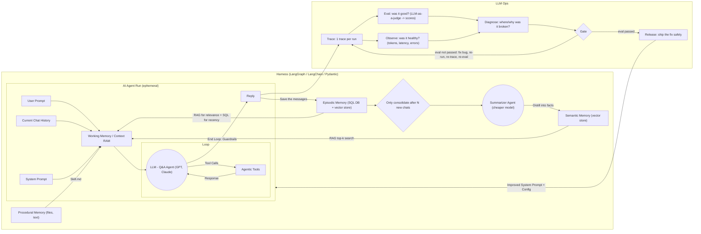

# Agent Harness — Architecture Reference

> **What this file is:** the source of truth for the agent harness I'm building. Read it before proposing designs or writing code. Use the names defined here. Anything under **Open decisions** has *not* been decided — ask me instead of assuming.
>
> Statements are tagged where it matters:
> - **(design)** = explicitly part of the architecture
> - **(inferred)** = a reasonable reading of the design, confirm if it affects your output

Last updated: 2026-10-18

---

## 1. Summary

A Q&A agent runs inside a **harness** (an orchestration layer such as LangGraph, LangChain or Pydantic AI). On each request, the harness builds a **working context** from the user's prompt, the current chat, the system prompt and three **long-term memory** stores. The LLM then **loops** with tools until **guardrails** end the loop and a **reply** goes out.

Every reply is saved to **episodic memory**. Episodic memory is periodically **consolidated** by a cheaper summarizer model into durable facts in **semantic memory**.

Separately, every run is **traced** and evaluated in an **LLM Ops** loop. Fixes that pass evaluation are **released** as an improved system prompt and config, which the next runs pick up.

Two loops, two timescales:

| Loop | Timescale | Purpose |
|---|---|---|
| Agent loop (LLM ↔ tools) | Within one request | Answer the user |
| Memory loop (save → consolidate → retrieve) | Across chats | Remember the user and past events |
| Improvement loop (trace → eval → release) | Across releases | Make the agent better over time |

---

## 2. Diagram

---

## 3. Glossary

| Term | Meaning in this project |
|---|---|
| **Harness** | Everything around the model: orchestration, context assembly, tool execution, memory reads/writes, guardrails. |
| **Agent run** | One end-to-end handling of one user request. All state inside it is **ephemeral**. |
| **Working Memory / Context RAM** | The assembled context window for this run: what the LLM actually sees. Rebuilt every run. |
| **Loop** | The LLM ↔ tools cycle within a run. |
| **Guardrails** | Checks applied when the loop ends, before anything reaches the user. |
| **Current Chat History** | Messages from the *current* conversation, passed in directly. |
| **Procedural memory** | *How to act*: skill instructions stored as files/text (e.g. `Skill.md`). |
| **Semantic memory** | *What is true*: durable facts and the user profile, in a vector store. |
| **Episodic memory** | *What happened*: dated events and *past* chat history, in a SQL DB + vector store. |
| **Consolidation** | Batch job that distills episodic memory into semantic facts. |
| **Trace** | Full record of one run (one trace per run). |
| **Eval** | Quality check: "was it good?", scored by an LLM judge. |
| **Observe** | Health check: "was it healthy?" (tokens, latency, errors). |
| **Gate** | Pass/fail decision that controls whether a fix may ship. |
| **Release** | Shipping a passed fix: prompt version, model config, tool change or RAG params. |

> **Don't conflate:** *Current Chat History* (this conversation, passed in directly) ≠ *past chat history* (earlier conversations, retrieved from episodic memory).

---

## 4. Components

### 4.1 Harness **(design)**

The orchestration layer that owns the agent run, the memory read/write paths and the consolidation job. Candidate frameworks: LangGraph, LangChain, Pydantic (AI). Framework choice is an open decision.

### 4.2 Agent run **(design)**

Everything inside the run is **ephemeral**: it exists only for the duration of the request. Persistence happens only through the explicit write paths: saving messages to episodic memory and emitting a trace.

**Inputs assembled into Working Memory:**

1. User Prompt: the new message.
2. Current Chat History: prior turns of this conversation.
3. System Prompt: the versioned prompt. It is a Release artifact.
4. Procedural memory, loaded via `Skill.md`.
5. Semantic memory, retrieved by RAG (top-k vector search).
6. Episodic memory, retrieved by RAG for relevance plus SQL for recency.

**The Loop:**

- The **LLM Q&A Agent** (a frontier model such as GPT or Claude) reasons over Working Memory.
- It issues **Tool Calls** to **Agentic Tools** and receives a **Response**, repeating as needed.
- Example tools **(design)**:
  - schedule a meeting
  - read/write in the CRM
  - fetch payment info
- When the LLM is done, the loop ends **through Guardrails**, which produce the **Reply**.

### 4.3 Long-term memory **(design)**

| Type | Holds | Storage | Read into Working Memory via | Written by |
|---|---|---|---|---|
| **Procedural** | How to act; skill instructions | Files / text | Loading skill files (`Skill.md`) | Not shown in the design (see Open decisions) |
| **Semantic** | Durable facts; user profile | Vector store | RAG, top-k similarity search | Summarizer Agent (consolidation) only |
| **Episodic** | Dated events; past chat history | SQL DB + vector store | RAG for relevance **+** SQL for recency | Every reply ("Save the messages") |

Why episodic memory uses both stores **(inferred)**: vector search finds past events that are *similar* to the current request, and SQL (ordered by timestamp) finds what happened *most recently*. Merging the two avoids missing recent-but-dissimilar context.

### 4.4 Write-back and consolidation **(design)**

1. After each run, the reply (and the messages of that exchange) is **saved to episodic memory** with a timestamp.
2. A consolidation check runs: **only consolidate after N new chats** since the last consolidation. Below N, do nothing.
3. When the threshold is reached, the **Summarizer Agent**, which runs on a **cheaper model** than the main agent, reads the new episodic records.
4. It **distills them into facts** and writes them to semantic memory (durable facts, user profile).

### 4.5 LLM Ops **(design)**

| Step | Question it answers | Mechanism |
|---|---|---|
| **Trace** | What happened? | Exactly 1 trace per run (e.g. LangFuse, LangSmith) |
| **Eval** | Was it good? | LLM-as-a-judge → scores |
| **Observe** | Was it healthy? | Tracks tokens, latency, errors |
| **Diagnose** | Where/why was it broken? | Investigate failing evals or unhealthy runs |
| **Gate** | Is the fix good enough to ship? | Pass → Release. Fail → fix bug, re-run, re-trace, re-eval |
| **Release** | Ship the fix safely | New prompt version, model config, tool change, or RAG param (top-k) |

The output of a Release is an **improved System Prompt + Config**, which feeds future agent runs.

**(inferred)** A trace should cover the whole run, not only the reply: assembled context, retrieval results, each tool call and response, the guardrail outcome, the final reply, token counts, latency and errors. Otherwise Diagnose can't localize failures.

---

## 5. Lifecycle of one request

1. User sends a message.
2. Harness starts a new, ephemeral agent run.
3. Harness assembles Working Memory:
   - user prompt
   - current chat history
   - current system prompt version
   - relevant skills (`Skill.md`)
   - top-k semantic facts
   - episodic events (relevant + recent)
4. LLM Q&A Agent reasons. If it needs a tool, it issues a tool call, gets a response, and continues. This repeats until it's ready to answer.
5. Loop ends; guardrails are applied.
6. Reply is returned to the user.
7. Messages are saved to episodic memory.
8. If N new chats have accumulated since the last consolidation, the Summarizer Agent distills them into semantic facts.
9. The run's trace is recorded (one trace per run) and becomes input to Eval and Observe.
10. Run state is discarded.

---

## 6. Improvement loop (offline, across releases)

1. Traces are scored (Eval) and monitored (Observe).
2. Failing or unhealthy runs are diagnosed: where did it break, and why?
3. A fix is made. The levers are:
   - system prompt version
   - model config
   - tool change
   - RAG parameters such as top-k
4. The fix is re-run, re-traced and re-evaluated until it **passes the Gate**.
5. The passing fix is released and becomes the system prompt + config for subsequent runs.

---

## 7. Invariants (must hold in any implementation)

1. **Run state is ephemeral.** Nothing inside the agent run persists unless written through an explicit path: episodic save, or trace.
2. **Three memory types stay separate.** Procedural (how to act), semantic (what's true) and episodic (what happened) have different storage, read paths and write paths. Don't merge them into one store.
3. **Episodic is written every run; semantic is written only by consolidation.** The main agent does not write facts directly to semantic memory.
4. **Consolidation is batched.** It runs only after N new chats, and uses a cheaper model than the main agent.
5. **The loop exits only through guardrails.** No reply bypasses them.
6. **Exactly one trace per run.**
7. **Nothing ships without passing the Gate.** Prompt, model, tool and RAG changes all go through Eval → Gate → Release.
8. **The system prompt and config are versioned release artifacts,** not ad-hoc edits.

---

## 8. Example technology mapping

These names come from the design as **examples**, not commitments.

| Concern | Examples |
|---|---|
| Harness / orchestration | LangGraph, LangChain, Pydantic |
| Main agent model | GPT, Claude |
| Summarizer model | A cheaper model (unspecified) |
| Procedural memory | Files / text, e.g. `Skill.md` |
| Semantic memory | A vector store (unspecified) |
| Episodic memory | A SQL DB + a vector store (unspecified) |
| Tracing / observability | LangFuse, LangSmith |
| Eval | LLM-as-a-judge |

---

## 9. Open decisions (not yet specified — ask, don't assume)

**Stack**
- Harness framework (LangGraph vs LangChain vs Pydantic AI).
- Concrete models for the main agent and for the summarizer.
- Concrete vector store and SQL database.

**Memory**
- Value of **N** (chats before consolidation), and whether it's per user or global.
- Default **top-k** for semantic and episodic retrieval.
- How relevance (vector) and recency (SQL) results are merged and de-duplicated for episodic memory.
- How the summarizer handles **conflicting or outdated facts** (overwrite, version, or keep both with timestamps).
- Whether consolidated episodic records are kept, archived or pruned, and the retention policy.
- Who writes and updates **procedural memory** (skills): developers only, or also via Release?
- How skills are selected: load all, or choose relevant `Skill.md` files per request.

**Loop and guardrails**
- Guardrail rules: content, PII and payment data, tool-action safety.
- Loop limits: max tool calls / iterations per run.
- Confirmation policy for **side-effecting tools** (CRM writes, scheduling) and handling of sensitive data (payment info).

**LLM Ops**
- Eval rubric for the LLM judge, and the score threshold that passes the Gate.
- Which Observe signals (tokens, latency, error rate) also block a release, and at what thresholds.
- Release mechanics: versioning scheme, rollout strategy, rollback.

---

## 10. When helping me build this

- Use the component names from this file in code, comments and explanations.
- Place every piece of code in one component (agent run, a specific memory type, consolidation, LLM Ops). If something doesn't fit, say so.
- If a request would break an invariant in §7, flag it before proceeding.
- If your answer depends on an item in §9, ask, or state your assumption explicitly and keep it easy to change.
